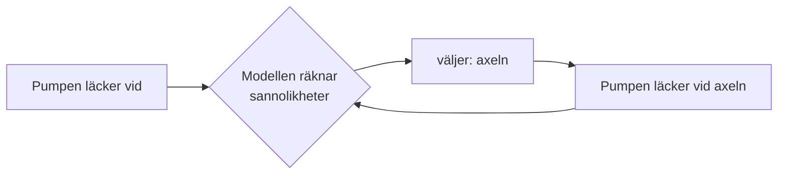

# 1. Vad är generativ AI?

I det här kapitlet lär du dig vad generativ AI är, hur en språkmodell skriver
text och vad den är bra och dålig på. Du behöver ingen dator ännu.

## Nordverk AB – kursens exempel

Genom hela kursen bygger du en AI-assistent åt **Nordverk AB**. Nordverk är ett
**påhittat** företag i Västerås som tillverkar och servar industripumpar. Pumparna
heter NV-200, NV-400 och NV-900. Nordverk har kunder som mejlar, tekniker som
skriver serviceprotokoll och manualer som ingen orkar läsa.

## AI, maskininlärning och generativ AI

| Begrepp | Betyder | Exempel |
|---------|---------|---------|
| **AI** (artificiell intelligens) | Datorprogram som löser uppgifter som vi tycker kräver intelligens | Ett schackprogram |
| **Maskininlärning** | AI som **lär sig av exempel** i stället för att någon skriver alla regler | Ett skräppostfilter som har sett tusentals mejl |
| **Generativ AI** | AI som **skapar nytt innehåll**: text, bild, ljud eller kod | ChatGPT, Copilot |

Generativ AI är en sorts maskininlärning, och maskininlärning är en sorts AI.

Ett skräppostfilter **klassar**: "Är det här skräppost, ja eller nej?"
En generativ AI **skapar**: "Skriv ett svar på det här mejlet."

En **språkmodell** (på engelska *Large Language Model*, **LLM**) är en
generativ AI som arbetar med text. Det är en sådan vi använder i kursen.

## Tokens

Modellen läser inte bokstäver eller hela ord. Den delar upp texten i
**tokens**: ett helt ord, en del av ett ord eller ett skiljetecken. Så här
delar kursens modell upp två meningar:

```
Pumpen läcker vid axeln.                          8 tokens
"Pump" "en" " lä" "cker" " vid" " ax" "eln" "."

The pump is leaking at the shaft.                 8 tokens
"The" " pump" " is" " leaking" " at" " the" " shaft" "."
```

Vanliga engelska ord blir ofta en hel token. Svenska ord och namn delas oftare
upp i bitar. Antalet tokens spelar roll, eftersom många leverantörer tar
betalt per token och modellen bara kan läsa ett visst antal åt gången.

## Hur en språkmodell skriver: nästa token

En språkmodell gör egentligen bara en sak: den **gissar nästa token**.

När texten är *"Pumpen läcker vid"* räknar modellen ut hur sannolik varje
möjlig fortsättning är. Siffrorna här är påhittade:

| Nästa token | Sannolikhet |
|-------------|-------------|
| axeln | 41 % |
| packningen | 22 % |
| anslutningen | 15 % |
| … (tusentals andra) | resten |

Modellen **väljer** en token, lägger till den och gör om samma sak. Och igen.
Ett svar på 200 ord är alltså hundratals gissningar i rad.



Modellen väljer inte alltid den mest sannolika. Hur mycket slump som får vara
med styrs av **temperaturen**, som du provar i kapitel 3.

💡 Modellen **slår inte upp** något när den svarar. Den skriver det som
*låter* mest troligt. Oftast är det rätt. Ibland inte.

## Hur modellen tränas

1. **Förträning.** Modellen läser enorma mängder text från webben, böcker och
   kod, och övar hela tiden på att gissa nästa token. Efter det kan den skriva
   text, men den är ingen bra assistent.
2. **Finjustering.** Modellen tränas vidare på exempel på frågor och bra svar.
   Människor betygsätter också svar. Nu lär den sig att följa instruktioner.

Kursen använder modellen **gpt-oss-120b** från OpenAI. Den har **öppna
vikter**, vilket betyder att vem som helst får köra den på egna servrar. Den
har tränats på text fram till **juni 2024**
([OpenAI:s modellsida](https://developers.openai.com/api/docs/models/gpt-oss-120b)).
Den **resonerar** också: den skriver en sorts kladd innan den svarar. Kladden
ser du i kapitel 2.

## Vad kan en språkmodell göra?

| Den kan | Exempel hos Nordverk |
|---------|----------------------|
| **Skriva** | Föreslå svar på kundmejl, översätta en manual |
| **Läsa** | Sammanfatta ett långt protokoll, sortera kundärenden, plocka ut felkoder ur fritext |
| **Chatta** | En kundtjänstassistent på webben |
| **Skriva kod** | Ett skript som räknar servicebesök per månad |

I den här modulen bygger du en chatt (kapitel 3) och låter modellen läsa
serviceprotokoll (kapitel 5).

## Begränsningar

| Begränsning | Betyder |
|-------------|---------|
| **Hallucinationer** | Modellen kan hitta på saker som låter rimliga men är fel. Den vet ingenting om Nordverk, men den vet hur ett svar om ett företag brukar låta. |
| **Kunskapsgräns** | Den vet bara det som fanns i träningsdatan. Nyheter efter juni 2024 och Nordverks interna dokument känner den inte till. |
| **Bias** (snedvridning) | Fördomar i träningstexterna följer med. Den kan till exempel anta att en tekniker är en man. |
| **Kontextfönster** | Den kan bara läsa ett visst antal tokens åt gången. Den minns inget mellan två frågor, så allt måste skickas med varje gång. |
| **Räknar dåligt** | Den gissar tokens. Exakta summor och sorteringar gör vanlig kod bättre. |

## När ska man inte använda en språkmodell?

- När en vanlig sökning, formel eller databasfråga räcker. Den är snabbare och
  alltid rätt.
- När svaret måste vara rätt varje gång och ingen kontrollerar det.
- När beslutet påverkar en människa, till exempel en anställning eller ett
  betyg. Då ska en människa bestämma.
- När texten innehåller personuppgifter eller hemligheter, innan du vet var
  modellen körs. Det är temat i [modul 03](../03-ai-losningar-for-foretag/README.md).

En bra tumregel: **språkmodellen föreslår, människan bestämmer.**

## Sammanfattning

- Generativ AI **skapar** nytt innehåll. En språkmodell (LLM) gör det med text.
- Texten delas upp i **tokens**. Modellen gissar en token i taget.
- Modellen kan skriva, läsa, chatta och skriva kod.
- Den kan hallucinera, har en kunskapsgräns, kan vara snedvriden och ser bara
  det som ryms i kontextfönstret.

Nästa kapitel: [Kom igång](02-kom-igang.md)
