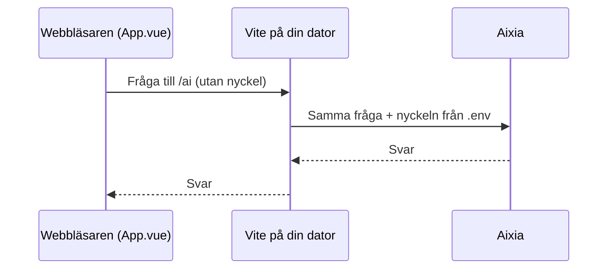

# 2. Kom igång

Nu gör du ditt första anrop till en språkmodell. Du startar Vue-projektet
[`nordverk-chatt`](nordverk-chatt/), som du sedan bygger vidare på i resten av
modulen.

## API och API-nyckel

Språkmodellen körs inte på din dator, utan på servrar hos en leverantör. Ditt
program pratar med den via ett **API**: programmet skickar en fråga över
internet och får tillbaka ett svar i JSON.

Kursen använder **Aixia**, en svensk leverantör som kör modellen
`gpt-oss-120b`. Aixias API fungerar precis som OpenAI:s, så vi kan använda
OpenAI:s JavaScript-paket `openai`.

För att få använda API:t behöver du en **API-nyckel**, en lång hemlig text som
börjar med `sk-`.

⚠️ **En API-nyckel är som ett lösenord.** Allt som görs med den räknas som
gjort av dig. Den får aldrig:

- klistras in i en chatt eller ett dokument,
- laddas upp på **GitHub**. Det finns robotar som letar efter nycklar där,
- ligga i kod som körs i **webbläsaren**. Den koden kan vem som helst läsa
  med **F12**.

## Steg 1 – Installera verktygen

Du behöver:

- Kursens repo på din dator (klona det med git eller ladda ner det som zip).

## Steg 2 – Lägg in nyckeln i .env

Öppna **hela repot** i VS Code (**File → Open Folder**, välj repots
rotmapp). Öppna en terminal (**Terminal → New Terminal**) och gör en kopia av
filen `.env.example` som heter `.env`:

```powershell
copy .env.example .env
```

(På Mac: `cp .env.example .env`.)

Öppna `.env` och byt `sk-din-nyckel-har` mot nyckeln från läraren. Spara.

```ini
AI_BASE_URL=https://llm.aiqu.ai/v1
AI_API_KEY=sk-din-nyckel-har
AI_MODEL=gpt-oss-120b
```

💡 `.env` står i filen `.gitignore`. Därför hoppar git över den, och den
hamnar inte på GitHub.

## Steg 3 – Starta Vue-projektet

Skriv i terminalen:

```powershell
cd 01-generativ-ai/nordverk-chatt
npm install
npm run dev
```

`npm install` laddar ner Vue, Vite och paketet `openai`. Det behöver du bara
göra en gång. `npm run dev` startar appen.

Öppna adressen som visas (oftast <http://localhost:5173>). Skriv en fråga och
klicka **Skicka**. Efter några sekunder kommer svaret. 🎉

💡 Står det `Hittar ingen AI_API_KEY` i terminalen? Då ligger `.env` på fel
ställe. Den ska ligga i **repots rotmapp**. Starta om med `npm run dev` när du
har flyttat den.

## Så skyddas nyckeln

Titta i `src/ai.js`. Där står ingen riktig nyckel:

```js
export const client = new OpenAI({
  baseURL: `${window.location.origin}/ai`,
  apiKey: 'laggs-till-av-servern',
  dangerouslyAllowBrowser: true,
})
```

Webbläsaren skickar inte frågan direkt till Aixia. Den skickar den till `/ai`
på **Vite**, utvecklingsservern som du startade med `npm run dev`. Vite körs
på din dator, inte i webbläsaren. Vite läser nyckeln från `.env`, lägger på
den och skickar frågan vidare. En server som skickar vidare på det sättet
kallas en **proxy**.



Koden för proxyn finns i [`gemensam/ai-vite.js`](../gemensam/ai-vite.js).

Paketet `openai` vägrar normalt att köras i en webbläsare, för att skydda dig
från att lägga en nyckel där. `dangerouslyAllowBrowser: true` stänger av det
skyddet. Det är ofarligt här, eftersom webbläsaren bara har en låtsasnyckel.
Gör det aldrig med en riktig nyckel.

⚠️ Proxyn finns bara när du kör `npm run dev`. En app som publiceras på
internet behöver en egen **backend**, ett serverprogram som håller nyckeln.

## Så fungerar App.vue

Öppna `src/App.vue`. Det viktigaste är funktionen `skicka`:

```js
async function skicka() {
  laddar.value = true
  svar.value = await chatta([
    { role: 'system', content: 'Du är en hjälpsam assistent. Svara kort på svenska.' },
    { role: 'user', content: fraga.value },
  ])
  laddar.value = false
}
```

`chatta()` finns i `src/ai.js`. Den skickar en lista med **meddelanden** till
modellen och returnerar svarstexten. Varje meddelande har en **roll**:

| Roll | Vem | Används till |
|------|-----|--------------|
| `system` | Du som utvecklare | Instruktioner: vem assistenten är och hur den ska svara. Kallas **systemprompt**. |
| `user` | Användaren | Frågan |
| `assistant` | Modellen | Modellens tidigare svar (används i kapitel 3) |

## Steg 4 – Titta på hela svaret

`chatta()` ger bara texten, men API:t skickar tillbaka mer än så. Gör så här
för att se allt:

**1.** Ändra importen högst upp i `<script setup>`:

```js
import { client, MODEL } from './ai.js'
```

**2.** Lägg till en `ref` under de andra:

```js
const helaSvaret = ref(null)
```

**3.** Byt ut `skicka` mot:

```js
async function skicka() {
  laddar.value = true
  const response = await client.chat.completions.create({
    model: MODEL,
    messages: [
      { role: 'system', content: 'Du är en hjälpsam assistent. Svara kort på svenska.' },
      { role: 'user', content: fraga.value },
    ],
  })
  helaSvaret.value = response
  svar.value = response.choices[0].message.content
  laddar.value = false
}
```

Det är samma anrop som `chatta()` gör, men nu sparar vi hela svaret.

**4.** Lägg till sist i `<template>`, före `</main>`:

```html
<pre v-if="helaSvaret">{{ helaSvaret }}</pre>
```

Nu ser du ungefär det här (förkortat):

```json
{
  "model": "gpt-oss-120b",
  "choices": [
    {
      "finish_reason": "stop",
      "message": {
        "role": "assistant",
        "content": "En token är en liten textbit …",
        "reasoning_content": "The user asks in Swedish: \"Vad är en token?\" …"
      }
    }
  ],
  "usage": {
    "prompt_tokens": 94,
    "completion_tokens": 113,
    "total_tokens": 207
  }
}
```

| Fält | Betyder |
|------|---------|
| `choices[0].message.content` | Själva svaret |
| `choices[0].message.reasoning_content` | Modellens kladd innan den svarade, ofta på engelska |
| `choices[0].finish_reason` | `stop` = klar. `length` = svaret blev avklippt. |
| `usage.prompt_tokens` | Hur många tokens du skickade in |
| `usage.completion_tokens` | Hur många tokens modellen skrev, kladden inräknad |

💡 Varför blir en kort fråga nästan 100 tokens? Meddelandena packas in i en
mall innan de når modellen, och mallen räknas också.

Hela filen finns i [`facit/App-kapitel-2.vue`](nordverk-chatt/facit/App-kapitel-2.vue).

## Om något går fel

Öppna **F12 → Console** i webbläsaren. Där står felet i rött.

| Felet | Trolig orsak |
|-------|--------------|
| `401 Authentication Error` | Fel nyckel i `.env`. Har du kopierat hela? |
| `403 The requested model … is not available` | Fel modellnamn i `AI_MODEL` |

💡 Ändrar du i `.env` måste du stoppa Vite (**Ctrl+C**) och köra `npm run dev`
igen.

## Sammanfattning

- Ditt program pratar med språkmodellen via ett **API**.
- **API-nyckeln** ligger i `.env`, som aldrig laddas upp.
- Webbläsaren ser aldrig nyckeln. Vite lägger på den (en **proxy**).
- Ett anrop är en lista med **meddelanden** med rollerna `system`, `user` och
  `assistant`.
- Svaret innehåller texten, `finish_reason` och `usage` (antal tokens).

## Övningar

Skriv all kod i `src/App.vue`. Lösningsförslag finns i
[losningar.md](losningar.md#kapitel-2--kom-igång).

**2.1** Öppna **F12 → Network** och skicka en fråga. Klicka på anropet
`completions` och leta upp `Authorization` under **Request Headers**. Vad står
där? Varför är det ofarligt?

**2.2** Ändra systemprompten så att assistenten svarar som en gammal
sjökapten.

**2.3** Fråga *"Vad gör företaget Nordverk AB i Västerås?"*. Stämmer svaret?
Vad kallas det som händer?

**2.4** Visa antalet tokens på sidan i stället för hela JSON-svaret:

```html
<p v-if="helaSvaret">Tokens in: {{ helaSvaret.usage.prompt_tokens }}</p>
```

Visa också `completion_tokens` på samma sätt.

**2.5** Jämför `prompt_tokens` när du skickar samma mening på svenska och på
engelska.

Nästa kapitel: [Chatt och systemprompt](03-chatt-och-systemprompt.md)
