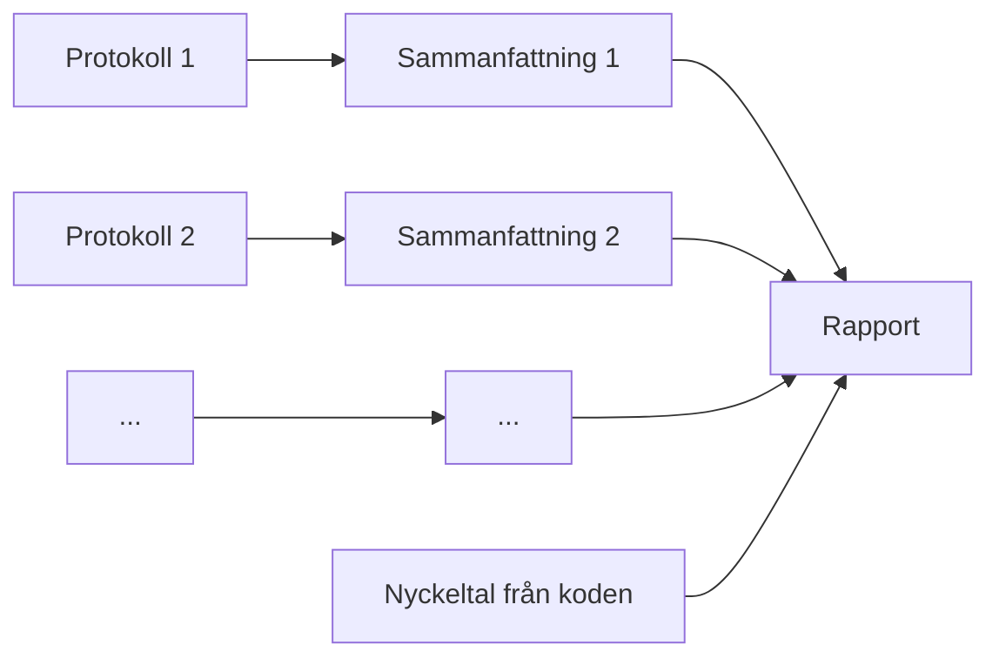

# 1. Rapporter från befintliga rapporter

Ett vanligt önskemål från företag är: *"Vi har massor av rapporter. Kan AI:n
sammanfatta dem åt oss?"* Hos Nordverk skriver teknikerna ett serviceprotokoll
efter varje besök. Varje månad vill servicechefen ha en månadsrapport: hur
många besök, vilka fel, vad det kostade och vad som behöver följas upp.

I det här kapitlet bygger du en knapp som skapar månadsrapporten för oktober
från de 12 protokollen i [`data/nordverk/serviceprotokoll`](../data/nordverk/serviceprotokoll/).

## Starta projektet

Koden finns i Vue-projektet [`nordverk-assistent`](nordverk-assistent/). Öppna
en terminal i mappen och skriv:

```
npm install
npm run dev
```

Öppna <http://localhost:5173>. Du ska se raden *Inläst: 3 manualer, 12
serviceprotokoll och 10 kundärenden*.

⚠️ **Nyckeln får aldrig ligga i webbläsaren.** Allt som skickas till
webbläsaren kan vem som helst läsa, till exempel i fliken *Network* (F12). Därför
pratar appen med `/ai` på din egen utvecklingsserver. Servern läser nyckeln från
`.env` i repots rot, lägger på den och skickar vidare till AI-tjänsten (se
`gemensam/ai-vite.js`). Den proxyn finns bara när du kör `npm run dev`. En
publicerad app behöver en egen backend som gör samma sak.

Datan läses in i `src/nordverk.js` med Vites `import.meta.glob`, som läser alla
filer som matchar ett mönster. `?raw` betyder "ge mig filen som text".

## Steg 1 – Hur mycket text är det?

En språkmodell kan bara läsa en viss mängd text åt gången. Det kallas
**kontextfönstret** och mäts i **tokens** (ordbitar). Allt räknas: systemprompt,
dina meddelanden och svaret.

De 12 protokollen är ungefär 2 100 ord. När vi skickade alla till
`gpt-oss-120b` blev det cirka 4 400 tokens. Det får lätt plats. Men ett helt år
är 150 protokoll, och ett stort företag har tusentals. Långa prompter tar
längre tid, kostar mer och gör att modellen lättare missar detaljer. Kontrollera
alltid hur stort kontextfönster din leverantör tillåter.

## Steg 2 – Låt koden räkna

Språkmodeller är bra på text men opålitliga på att räkna. De kan skriva 12 när
det är 11, eller hitta på en summa som ser rimlig ut. **Allt som går att räkna
ska koden räkna.**

Protokollen börjar med en tabell med fasta fält:

```
| Arbetstid | 5,5 h |
| Status | Avslutat |
```

Filen `src/protokoll.js` finns redan i projektet. Den läser tabellerna rad för
rad utan AI och räknar nyckeltal. Det viktigaste:

```js
const celler = rad.split('|').map((cell) => cell.trim())
// "| Datum | 2026-10-01 |" blir ['', 'Datum', '2026-10-01', '']
if (celler.length === 4) {
  falt[celler[1]] = celler[2]
}
```

`raknaNyckeltal(protokoll)` ger ett objekt som det här:

```js
{
  antalBesok: 12,
  perPumpmodell: { 'NV-900': 4, 'NV-400': 5, 'NV-200': 3 },
  perFelkod: { '–': 4, E05: 2, E08: 2, E04: 1, E06: 1, E01: 1, E09: 1 },
  arbetstidTimmar: 44,
  reservdelarKronor: 33260,
  uppfoljningKravs: ['SP-2026-1004', 'SP-2026-1008'],
}
```

💡 `–` betyder att besöket inte hade någon felkod, till exempel en vanlig
service.

## Steg 3 – Map–reduce

Modellen ska skriva texten: vad som hänt, vilka problem som återkommer och vad
Nordverk bör göra. Vi delar upp jobbet i två steg:



1. **Map:** varje protokoll sammanfattas för sig i två meningar.
2. **Reduce:** sammanfattningarna och nyckeltalen blir en rapport.

Varje anrop blir litet, och det fungerar lika bra med 1 000 protokoll som med
12. `Promise.all` skickar alla sammanfattningar samtidigt och väntar tills alla
är klara.

## Steg 4 – En mall

Utan mall ser rapporten olika ut varje gång. Med en mall vet modellen vilka
rubriker som ska finnas:

```
## Sammanfattning
(3–4 meningar om månaden)

## Återkommande problem
(punktlista: kund, pump och vad som hänt)

## Rekommendationer
(3–5 punkter)
```

Nyckeltalen överst i rapporten skriver koden själv. Där kan modellen inte göra fel.

## Steg 5 – Kontrollera siffrorna

Modellen kan ändå skriva tal i texten. Funktionen `kontrolleraSiffror` letar
upp alla tal i modellens text och varnar för tal som inte finns någonstans i
underlaget. Den hittar inte alla fel, men den fångar påhittade siffror.

## Hela komponenten

Skapa filen `src/Manadsrapport.vue`:

```vue
<script setup>
import { ref } from 'vue'
import { chatta } from './ai.js'
import { protokoll, raknaNyckeltal } from './protokoll.js'

const rapport = ref('')
const status = ref('')
const varningar = ref([])

// Mallen som modellen ska fylla i.
const mall = `## Sammanfattning
(3–4 meningar om månaden)

## Återkommande problem
(punktlista: kund, pump och vad som hänt)

## Rekommendationer
(3–5 punkter)`

// Map: sammanfatta ett protokoll.
async function sammanfatta(p) {
  return chatta([
    {
      role: 'system',
      content: 'Sammanfatta serviceprotokollet i högst två meningar på svenska: vad som var fel och vad som gjordes.',
    },
    { role: 'user', content: p.text },
  ])
}

// Hittar tal i texten som inte finns i underlaget.
function kontrolleraSiffror(text, underlag) {
  // "33 260" ska räknas som 33260, så vi tar bort mellanslag inne i tal.
  const hittaTal = (t) => t.replace(/(\d)\s(\d{3})/g, '$1$2').match(/\d+(,\d+)?/g) ?? []
  const iUnderlaget = hittaTal(underlag)
  return hittaTal(text).filter((t) => !iUnderlaget.includes(t))
}

async function skapaRapport() {
  rapport.value = ''
  varningar.value = []

  // 1. Koden räknar.
  const nyckeltal = raknaNyckeltal(protokoll)

  // 2. Map: alla protokoll sammanfattas samtidigt.
  status.value = `Sammanfattar ${protokoll.length} protokoll …`
  const sammanfattningar = await Promise.all(protokoll.map(sammanfatta))

  // 3. Reduce: en text av nyckeltal och sammanfattningar.
  status.value = 'Skriver rapporten …'
  let underlag = 'NYCKELTAL:\n' + JSON.stringify(nyckeltal, null, 2) + '\n\nPROTOKOLL:\n'
  for (let i = 0; i < protokoll.length; i++) {
    const p = protokoll[i]
    underlag += `${p.nummer}, ${p.datum}, ${p.kund}, ${p.serienummer}: ${sammanfattningar[i]}\n`
  }

  const text = await chatta([
    {
      role: 'system',
      content:
        'Du skriver Nordverks månadsrapport för service. Följ mallen och skriv på svenska. ' +
        'Använd bara fakta och siffror från underlaget.',
    },
    { role: 'user', content: `MALL:\n${mall}\n\nUNDERLAG:\n${underlag}` },
  ])

  // 4. Siffrorna överst kommer från koden, texten från modellen.
  rapport.value =
    '# Servicerapport oktober 2026\n\n' +
    `Antal besök: ${nyckeltal.antalBesok}\n` +
    `Arbetstid: ${nyckeltal.arbetstidTimmar} timmar\n` +
    `Reservdelar: ${nyckeltal.reservdelarKronor} kr\n` +
    `Uppföljning krävs: ${nyckeltal.uppfoljningKravs.join(', ')}\n\n` +
    text

  // 5. Kontrollera talen i modellens text.
  varningar.value = kontrolleraSiffror(text, underlag)
  status.value = ''
}
</script>

<template>
  <section>
    <h2>Månadsrapport</h2>
    <button @click="skapaRapport" :disabled="status !== ''">Skapa rapport för oktober</button>
    <p v-if="status">{{ status }}</p>
    <p v-if="varningar.length">⚠️ Kontrollera de här talen: {{ varningar.join(', ') }}</p>
    <pre v-if="rapport">{{ rapport }}</pre>
  </section>
</template>
```

Lägg till komponenten i `src/App.vue`. Överst i `<script setup>`:

```js
import Manadsrapport from './Manadsrapport.vue'
```

Och i `<template>`, där kommentaren står:

```html
<Manadsrapport />
```

Klicka på **Skapa rapport för oktober**. Det tar 10–20 sekunder. Ett utdrag
från en av våra körningar:

```
# Servicerapport oktober 2026

Antal besök: 12
Arbetstid: 44 timmar
Reservdelar: 33260 kr
Uppföljning krävs: SP-2026-1004, SP-2026-1008

## Återkommande problem
- Björkvik Papper AB – Pump NV-400 (2022-0118) – flera gånger slitet
  kopplingsgummi samt obalans och slitna lager, vilket gett hög vibration.
...
```

⚠️ I samma körning skrev modellen *"Åtta olika felkoder registrerades"*. Det
stämmer inte, och kontrollen märkte inget eftersom talet var skrivet med
bokstäver. **En människa ska alltid läsa rapporten innan den skickas.**

## Sammanfattning

| Begrepp | Betyder |
|---|---|
| Kontextfönster | Hur mycket text modellen kan läsa åt gången, mätt i tokens |
| Map–reduce | Sammanfatta varje dokument för sig, sedan alla sammanfattningar ihop |
| Mall | En färdig struktur som modellen fyller i |
| Koden räknar | Siffror räknas av programmet, modellen skriver bara text |

Nästa kapitel: [RAG med sökning](02-rag-med-sokning.md)
