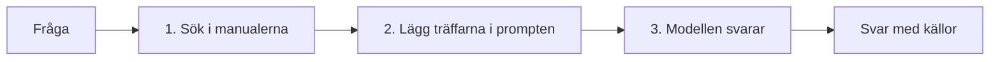

# 2. RAG med sökning

Fråga startsidans assistent *"Vad tillverkar Nordverk?"*. I ett av våra test
svarade den: *"Nordverk tillverkar skräddarsydda metall- och träprodukter för
industri- och byggsektorn."* Det är påhittat. Modellen har aldrig sett Nordverks
manualer, så den gissar. Det kallas att modellen **hallucinerar**.

Lösningen är att ge modellen rätt text i prompten. Men vi kan inte skicka alla
dokument varje gång. Därför söker vi först fram de delar som passar frågan.

## Vad är RAG?

**RAG** står för *Retrieval-Augmented Generation*: generering med hjälp av
hämtad text. Det sker i tre steg:



| Steg | Engelska | Vem gör det? |
|---|---|---|
| 1. Hämta texter som passar frågan | Retrieval | Koden |
| 2. Lägg in dem i prompten | Augmentation | Koden |
| 3. Skriv svaret utifrån texterna | Generation | Modellen |

Fördelar: modellen svarar utifrån företagets egna dokument, du kan visa källan,
och när en manual ändras behöver du bara byta filen.

## Steg 1 – Dela manualerna i avsnitt

En hel manual är för stor och handlar om många saker. Vi delar den vid varje
rubrik som börjar med `## `. Varje avsnitt får en källa, till exempel
`NV-400, Felkoder`.

## Steg 2 – Nyckelordssökning

Den enklaste sökningen: räkna hur många ord i frågan som också finns i
avsnittet. Vanliga ord som "och" och "hur" säger inget om innehållet. De kallas
**stoppord** och räknas inte.

Skapa filen `src/sok.js`:

```js
// Enkel nyckelordssökning i manualerna.
import { manualer } from './nordverk.js'

// Delar en manual i avsnitt vid varje rubrik som börjar med "## ".
function delaManual(manual) {
  const modell = manual.text.match(/^# Manual (\S+)/m)[1] // t.ex. "NV-400"
  return manual.text
    .split(/\n(?=## )/) // dela före varje "## "
    .slice(1) // hoppa över titeln överst
    .map((avsnitt) => ({
      kalla: `${modell}, ${avsnitt.split('\n')[0].replace('## ', '')}`, // "NV-400, Felkoder"
      text: avsnitt,
    }))
}

export const avsnitt = manualer.flatMap(delaManual)

// Vanliga ord som inte säger något om innehållet.
const stoppord = new Set([
  'och', 'att', 'det', 'som', 'en', 'ett', 'är', 'på', 'för', 'med', 'vad', 'hur',
  'den', 'till', 'av', 'om', 'jag', 'vi', 'kan', 'ska', 'har', 'när', 'inte', 'i',
  'vår', 'våra', 'min', 'man', 'betyder', 'ofta', 'pumpen', 'pump',
])

// Gör om en text till en lista med ord: små bokstäver, utan stoppord.
export function ord(text) {
  const allaOrd = text.toLowerCase().match(/[a-zåäöé0-9-]+/g) ?? []
  return allaOrd.filter((o) => o.length > 1 && !stoppord.has(o))
}

// Ger de avsnitt som har flest ord gemensamt med frågan.
export function nyckelordssok(fraga, antal = 3) {
  const fragaOrd = new Set(ord(fraga))
  return avsnitt
    .map((a) => ({
      ...a,
      poang: ord(a.kalla + ' ' + a.text).filter((o) => fragaOrd.has(o)).length,
    }))
    .filter((a) => a.poang > 0)
    .sort((a, b) => b.poang - a.poang)
    .slice(0, antal)
}
```

## Steg 3 – Prompten

Träffarna numreras och läggs i prompten. Systemprompten säger tre saker:

1. Svara **bara** utifrån underlaget.
2. Skriv källans nummer, till exempel `[1]`. Då kan användaren kontrollera svaret.
3. Om svaret inte finns: säg det. Det är bättre att säga "vet inte" än att gissa.

Om sökningen inte hittar något alls frågar vi inte ens modellen. Då kan den
inte hitta på.

Skapa filen `src/FragaManualen.vue`:

```vue
<script setup>
import { ref } from 'vue'
import { chatta } from './ai.js'
import { nyckelordssok } from './sok.js'

const fraga = ref('')
const svar = ref('')
const traffar = ref([])
const laddar = ref(false)

async function fragaManualen() {
  laddar.value = true
  svar.value = ''

  // 1. Sök (retrieval)
  traffar.value = nyckelordssok(fraga.value)

  // Ingen träff: fråga inte ens modellen.
  if (traffar.value.length === 0) {
    svar.value = 'Det står inte i manualerna.'
    laddar.value = false
    return
  }

  // 2. Lägg in träffarna i prompten (augmentation)
  const underlag = traffar.value
    .map((t, i) => `[${i + 1}] Källa: ${t.kalla}\n${t.text}`)
    .join('\n\n')

  // 3. Låt modellen skriva svaret (generation)
  svar.value = await chatta([
    {
      role: 'system',
      content:
        'Du är Nordverks serviceassistent. Svara kort på svenska och bara utifrån underlaget. ' +
        'Skriv källans nummer inom hakparentes efter det du hämtat därifrån, till exempel [1]. ' +
        'Om svaret inte finns i underlaget, svara exakt: "Det står inte i manualerna."',
    },
    { role: 'user', content: `UNDERLAG:\n${underlag}\n\nFRÅGA: ${fraga.value}` },
  ])
  laddar.value = false
}
</script>

<template>
  <section>
    <h2>Fråga manualen</h2>
    <form @submit.prevent="fragaManualen">
      <input v-model="fraga" placeholder="Till exempel: Vad betyder E06 på NV-400?" />
      <button :disabled="laddar || !fraga">Sök och svara</button>
    </form>
    <p v-if="laddar">Söker och tänker …</p>
    <p v-if="svar">{{ svar }}</p>
    <ol v-if="traffar.length">
      <li v-for="t in traffar" :key="t.kalla">{{ t.kalla }} (poäng {{ t.poang }})</li>
    </ol>
  </section>
</template>
```

Lägg till `import FragaManualen from './FragaManualen.vue'` och
`<FragaManualen />` i `App.vue`, som i kapitel 1.

## Testa

| Fråga | Vad som hände hos oss |
|---|---|
| Vad betyder E06 på NV-400? | "Igensatt inloppsfilter (tryckfall över 0,5 bar) ... [2]" |
| Hur ofta ska axeltätningen bytas på NV-200? | "Var 24:e månad ... Om pumpen körs dygnet runt ... var 12:e månad. [1]" |
| Vad kostar en NV-200? | "Det står inte i manualerna." (Det fanns träffar, men inget pris.) |
| Pumpen skakar och låter konstigt | "Det står inte i manualerna." (Ingen träff alls.) |

Den sista frågan visar problemet med nyckelord. Manualen skriver *vibration*,
inte *skakar*. Ordet måste stämma exakt. Det löser vi i nästa kapitel.

## Sammanfattning

| Begrepp | Betyder |
|---|---|
| Hallucination | Modellen hittar på något som låter rimligt |
| RAG | Sök fram text, lägg den i prompten, låt modellen svara |
| Nyckelordssökning | Räkna gemensamma ord mellan fråga och text |
| Stoppord | Vanliga ord som inte räknas i sökningen |
| Källhänvisning | Svaret visar vilken text det bygger på |

## Övningar

Lösningar finns i [losningar.md](losningar.md#kapitel-2--rag-med-sökning).

**2.1** Ställ frågorna i tabellen ovan. Ställ sedan samma frågor i
startsidans assistent, som inte har RAG. Jämför svaren.

**2.2** Visa texten som skickades till modellen. Lägg till en `<details>` under
varje källa i listan med `{{ t.text }}` inuti.

**2.3** Låt sökningen ge 2 träffar i stället för 3. Blir svaren bättre eller sämre?

Nästa kapitel: [RAG med embeddings](03-rag-med-embeddings.md)
