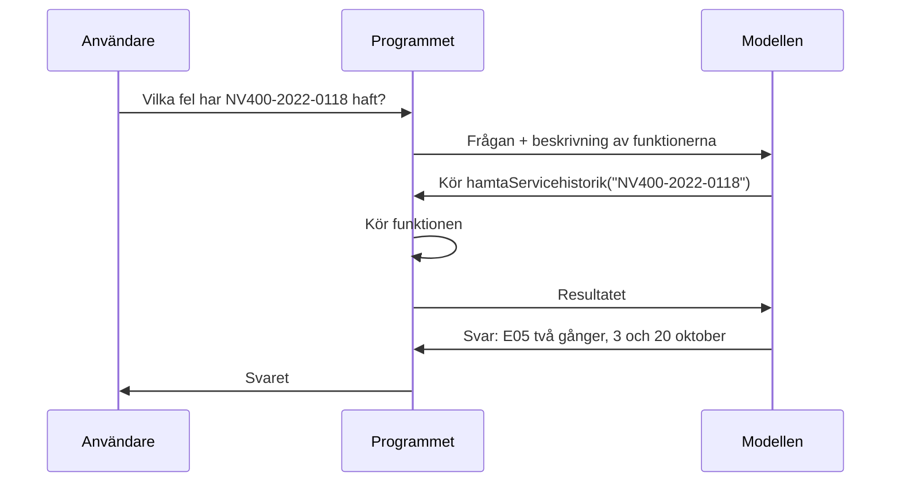

# 4. Verktygsanrop

RAG ger modellen text att läsa. Men ibland behöver modellen **göra** något,
till exempel hämta servicehistoriken för en viss pump. Modellen kan inte köra
kod själv. Däremot kan den **be ditt program** att köra en funktion. Det kallas
**verktygsanrop** (engelska *tool calling* eller *function calling*).



Det viktiga: **modellen bestämmer vilken funktion och vilket argument, men
programmet kör den.** Programmet kör bara funktioner som finns i dess lista.

## Den inbyggda parametern `tools`

Många leverantörer har inbyggt stöd. Du skickar med en lista med verktyg:

```js
const response = await client.chat.completions.create({
  model: MODEL,
  messages,
  tools: [
    {
      type: 'function',
      function: {
        name: 'hamtaServicehistorik',
        description: 'Hämtar alla serviceprotokoll för en pump.',
        parameters: {
          type: 'object',
          properties: { serienummer: { type: 'string' } },
          required: ['serienummer'],
        },
      },
    },
  ],
})
```

Vill modellen använda verktyget kommer svaret i `message.tool_calls` i stället
för i `message.content`. Programmet kör funktionen och skickar tillbaka
resultatet i ett meddelande med `role: 'tool'`.

⚠️ **Hos Aixia fungerar det inte just nu.** Modellen vill anropa verktyget, men
svaret kommer tillbaka med `content: null` och utan `tool_calls`. Servern som
kör modellen är inte inställd för att läsa ut verktygsanrop. Kontrollera aktuell
status. Vi bygger därför samma sak själva med **strukturerad utdata**: modellen
svarar med JSON enligt ett schema, och koden läser JSON:en. Idén är exakt
densamma. Det är bara formatet som skiljer.

## Vårt format

Modellen svarar med ett JSON-objekt per steg:

```json
{ "typ": "anropa", "funktion": "hamtaServicehistorik", "argument": "NV400-2022-0118", "text": "" }
```

eller, när den kan svara:

```json
{ "typ": "svar", "funktion": "ingen", "argument": "", "text": "Pumpen har haft E05 två gånger ..." }
```

Två saker gjorde det pålitligt i våra tester:

- **Exempel i systemprompten.** Utan dem hittade modellen ibland på egna fält.
- **Ordet "funktioner" i stället för "verktyg".** När prompten talade om verktyg
  försökte modellen ibland använda det inbyggda formatet, och då kom inget svar.

## Steg 1 – Funktionerna

Skapa filen `src/verktyg.js`. Funktionerna är vanlig JavaScript utan AI.
`nastaSteg` skickar meddelandena med ett JSON-schema och gör om svaret till ett
objekt.

```js
// Verktygen som modellen kan be programmet att köra.
import { chatta } from './ai.js'
import { manualer } from './nordverk.js'
import { protokoll } from './protokoll.js'

// Verktyg 1: alla serviceprotokoll för en pump.
function hamtaServicehistorik(serienummer) {
  const traffar = protokoll.filter((p) => p.serienummer === serienummer)
  if (traffar.length === 0) return 'Det finns inga serviceprotokoll för ' + serienummer
  return traffar.map((p) => p.text).join('\n\n')
}

// Verktyg 2: vad en felkod betyder, i alla manualer där den finns.
function slaUppFelkod(kod) {
  const rader = []
  for (const manual of manualer) {
    const modell = manual.text.match(/# Manual (\S+)/)[1]
    const rad = manual.text.split('\n').find((r) => r.startsWith(`| ${kod} |`))
    if (rad) rader.push(modell + ': ' + rad)
  }
  if (rader.length === 0) return 'Felkoden ' + kod + ' finns inte i manualerna.'
  return rader.join('\n')
}

// Namn → funktion. Programmet kör bara funktioner som står här.
export const verktyg = { hamtaServicehistorik, slaUppFelkod }

// Beskrivningen som modellen får läsa i systemprompten.
export const beskrivning = `- hamtaServicehistorik: hämtar alla serviceprotokoll för en pump. Argument: serienumret, t.ex. NV400-2022-0118.
- slaUppFelkod: slår upp en felkod i manualerna. Argument: felkoden, t.ex. E05.`

// Frågar modellen om nästa steg. Svaret är ett objekt enligt schemat:
// { typ: 'anropa' eller 'svar', funktion, argument, text }
export async function nastaSteg(meddelanden, funktionsnamn) {
  const schema = {
    type: 'object',
    properties: {
      typ: { type: 'string', enum: ['anropa', 'svar'] },
      funktion: { type: 'string', enum: [...funktionsnamn, 'ingen'] },
      argument: { type: 'string' },
      text: { type: 'string' },
    },
    required: ['typ', 'funktion', 'argument', 'text'],
    additionalProperties: false,
  }
  const text = await chatta(meddelanden, {
    response_format: { type: 'json_schema', json_schema: { name: 'steg', strict: true, schema } },
  })
  try {
    return JSON.parse(text)
  } catch {
    return { typ: 'svar', text: 'Modellen svarade inte med giltig JSON. Försök igen.' }
  }
}
```

`enum` i schemat betyder att fältet bara får ha ett av värdena i listan. Då kan
modellen inte hitta på en funktion som inte finns.

## Steg 2 – Loopen

1. Skicka frågan och beskrivningen av funktionerna.
2. Är svaret `"anropa"`? Kör funktionen, lägg till resultatet i meddelandena och
   gå till 1.
3. Är svaret `"svar"`? Visa det.

Loopen får gå högst tre varv. Då kan den aldrig fastna.

Skapa filen `src/Verktyg.vue`:

```vue
<script setup>
import { ref } from 'vue'
import { verktyg, beskrivning, nastaSteg } from './verktyg.js'

const fraga = ref('')
const svar = ref('')
const logg = ref([])
const laddar = ref(false)

const systemprompt = `Du är Nordverks serviceassistent. Svara på svenska.
Programmet kan köra de här funktionerna åt dig:
${beskrivning}

Svara med ett JSON-objekt, ett steg i taget. Exempel:
- Behöver du fakta: {"typ": "anropa", "funktion": "slaUppFelkod", "argument": "E05", "text": ""}
- Kan du svara: {"typ": "svar", "funktion": "ingen", "argument": "", "text": "Ditt svar här"}
Hitta aldrig på fakta om pumpar och felkoder. Hämta dem med en funktion.`

async function stall() {
  laddar.value = true
  svar.value = ''
  logg.value = []
  const meddelanden = [
    { role: 'system', content: systemprompt },
    { role: 'user', content: fraga.value },
  ]

  // Högst tre varv. Då kan modellen inte fastna i en evig loop.
  for (let varv = 1; varv <= 3; varv++) {
    const steg = await nastaSteg(meddelanden, Object.keys(verktyg))

    if (steg.typ === 'svar') {
      svar.value = steg.text
      break
    }

    // Modellen vill köra en funktion. Det är programmet som kör den.
    logg.value.push(`${steg.funktion}("${steg.argument}")`)
    const resultat = verktyg[steg.funktion](steg.argument)

    // Skicka tillbaka modellens begäran och resultatet.
    meddelanden.push({ role: 'assistant', content: JSON.stringify(steg) })
    meddelanden.push({ role: 'user', content: `Resultat från ${steg.funktion}:\n${resultat}` })
  }
  if (!svar.value) svar.value = 'Assistenten blev inte klar på tre varv.'
  laddar.value = false
}
</script>

<template>
  <section>
    <h2>Assistent med verktyg</h2>
    <form @submit.prevent="stall">
      <input v-model="fraga" placeholder="Till exempel: Vilka fel har NV400-2022-0118 haft?" />
      <button :disabled="laddar || !fraga">Fråga</button>
    </form>
    <p v-if="laddar">Arbetar …</p>
    <ul class="logg">
      <li v-for="(rad, i) in logg" :key="i">🔧 {{ rad }}</li>
    </ul>
    <p v-if="svar">{{ svar }}</p>
  </section>
</template>
```

Lägg till `import Verktyg from './Verktyg.vue'` och `<Verktyg />` i `App.vue`.

## Testa

| Fråga | Funktionsanrop hos oss |
|---|---|
| Vilka fel har NV400-2022-0118 haft? | `hamtaServicehistorik("NV400-2022-0118")` |
| Vad betyder E09 på NV-900? | `slaUppFelkod("E09")` |
| Vad betyder E05 på NV-400 och har NV400-2022-0119 haft det felet? | `slaUppFelkod("E05")`, sedan `hamtaServicehistorik("NV400-2022-0119")` |
| Vad är huvudstaden i Norge? | Inget. Modellen svarar direkt. |

## Sammanfattning

| Begrepp | Betyder |
|---|---|
| Verktygsanrop | Modellen ber programmet köra en funktion |
| `tools` | Inbyggd parameter för verktyg hos många leverantörer |
| Strukturerad utdata | Modellen svarar med JSON enligt ett schema |
| `enum` | Fältet får bara ha ett av de listade värdena |

## Övningar

Lösningar finns i [losningar.md](losningar.md#kapitel-4--verktygsanrop).

**4.1** Ställ frågorna i tabellen. Fråga sedan om ett serienummer som inte finns,
till exempel `NV200-2020-9999`. Vad svarar assistenten?

**4.2** Lägg till en tredje funktion, `sokIManualer(fraga)`, som använder
`nyckelordssok` från kapitel 2 och returnerar texten i träffarna. Glöm inte
beskrivningen. Fråga *"Hur mycket väger en NV-900?"*.

Nästa kapitel: [Agenter](05-agenter.md)
