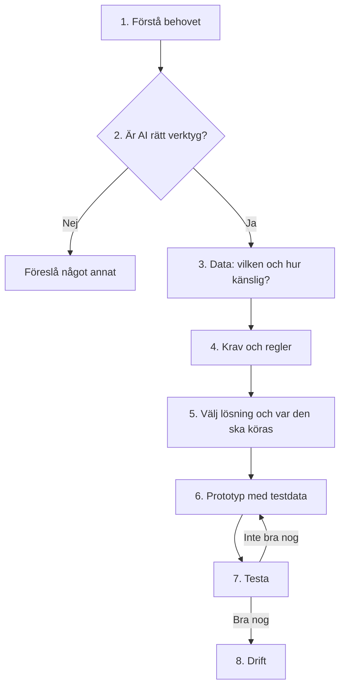

# 1. Från behov till AI-lösning

Ett företag säger sällan "vi vill ha en språkmodell". De säger något i stil
med: *"Vi lägger två dagar varje månad på att skriva servicerapporten. Kan AI
göra det?"* Ditt jobb är att ta reda på vad de egentligen behöver, och om AI
är rätt sätt att lösa det.

## Processen



I verkligheten går man fram och tillbaka. Upptäcker du i steg 3 att datan är
känsligare än du trodde, får du göra om steg 4 och 5.

### 1. Förstå behovet

Börja med **problemet**, inte med tekniken. Be företaget visa hur de gör i
dag. Ta reda på vem som har problemet, varför det är ett problem och hur ni
ska märka att det blivit bättre. Skriv behovet i en mening:

*"Servicechefen behöver en månadsrapport om alla servicebesök, och i dag tar
det två dagar att skriva den."*

### 2. Är AI rätt verktyg?

| Språkmodellen är bra på | Använd hellre något annat till |
|-------------------------|--------------------------------|
| Sammanfatta och skriva om text | Räkna exakt (summor, antal) – gör det i kod |
| Hitta det viktiga i fri text | Sådant som måste bli exakt likadant varje gång |
| Sortera ärenden i kategorier | Fakta den inte har fått (då hittar den på) |
| Skriva utkast som en människa granskar | Beslut om människor |

En bra lösning blandar ofta: **kod gör det exakta, modellen gör texten.** För
månadsrapporten räknar koden besök, felkoder och timmar, och modellen skriver
texten utifrån siffrorna. Ibland behövs ingen AI alls, till exempel om
problemet egentligen är att protokollen skrivs på tre olika sätt.

### 3. Data

Vilken data behövs, var finns den och **hur känslig** är den? Det är den
viktigaste frågan, eftersom den styr vilka lösningar som är möjliga. Du lär
dig klassa data i kapitel 2. Be också om **testdata**: påhittad data som
liknar den riktiga.

### 4. Krav och regler

Vilken säkerhetsnivå har datan? Får den lämna företaget, Sverige, EU? Vilka
lagar gäller (kapitel 3)? Hur ofta får lösningen ha fel? Vad får den kosta?
Vem granskar det AI:n skriver?

### 5. Välj lösning

| Typ av lösning | Exempel |
|----------------|---------|
| Färdig tjänst | En agent i Microsoft 365, om företaget redan har det |
| Egen app mot ett API | En Vue-app som anropar Aixia, som i kursen |
| Lokal modell | Ollama på en dator hos företaget |
| Ingen AI | En mall, ett formulär, en vanlig Excel-rapport |

Samtidigt väljer ni **var** modellen ska köras, alternativ A–D. Det gör du i
kapitel 4.

### 6–8. Prototyp, test och drift

Bygg det minsta som visar om idén fungerar, med testdata. Testa med
**testfall**: frågor där du vet vilket svar som är rätt (kapitel 6). När
lösningen används på riktigt behöver någon äga den, köra testerna igen när
modellen byts ut och ta emot felrapporter.

## Frågor att ställa till företaget

Ta med listan till första mötet.

**Behov**

1. Vilket problem vill ni lösa? Kan ni visa hur ni gör i dag?
2. Vem ska använda lösningen, och hur ofta?
3. Hur ser ett bra resultat ut? Hur mäter vi att det blivit bättre?

**Data**

4. Vilken data behövs, och var finns den?
5. Finns det personuppgifter i datan? Uppgifter om hälsa?
6. Finns det affärshemligheter, priser, avtal eller ritningar?
7. Gäller sekretessavtal, säkerhetsskydd eller exportkontroll?
8. Kan vi få testdata?

**Regler och ansvar**

9. Har ni regler för vilka AI-tjänster som får användas?
10. Får datan behandlas utanför företaget? Utanför Sverige eller EU?
11. Använder ni Microsoft 365, och har ni licenser för AI-funktioner?
12. Vem granskar det AI:n skriver, och vem förvaltar lösningen efteråt?

## Exempel: Nordverks månadsrapport

| Steg | Nordverk (påhittat företag) |
|------|-----------------------------|
| Behov | Servicechefen lägger två dagar per månad på en rapport om servicebesöken. |
| AI rätt verktyg? | Delvis. Siffrorna räknas i kod, texten skrivs av modellen. |
| Data | Serviceprotokoll med kundnamn, teknikernamn, felkoder och tid. |
| Säkerhetsnivå | Nivå 3 (namn och kunddata). Nivå 2 om namnen tas bort först. |
| Lösning | Ett skript räknar och tar bort namn. En modell i Sverige (Aixia) skriver texten. |
| Mått | Rapporten tar högst två timmar inklusive granskning. Siffrorna stämmer. |

Lägg märke till att ett enkelt val, att ta bort namnen innan modellen får
texten, sänker säkerhetsnivån. Det kallas **dataminimering**.

## Lösningsskiss

Sammanfatta utredningen innan du bygger:

```
Lösningsskiss: <namn>
Behov:             <en mening>
Användare:         <vem>
Vad gör AI, vad gör kod, vad gör människan?
Data:              <vilken data, var den finns>
Säkerhetsnivå:     <1–4 med motivering>
Driftalternativ:   <A–D med motivering>
Mått på framgång:  <hur vi vet att det fungerar>
Största riskerna:  <tre stycken, och vad vi gör åt dem>
```

I modul 04 skriver du en sådan skiss för ditt företagscase.

## Sammanfattning

- Börja med problemet, inte med tekniken.
- Låt kod göra det exakta och modellen göra texten.
- Datan och dess säkerhetsnivå styr vilka lösningar som är möjliga.
- Bygg en liten prototyp med testdata och testa den med testfall.

Nästa kapitel: [Data och säkerhetsnivåer](02-data-och-sakerhetsnivaer.md)
