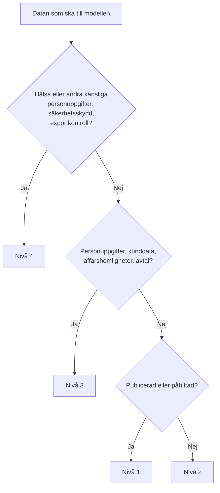

# 2. Data och säkerhetsnivåer

Allt du skickar till en språkmodell lämnar ditt program och hamnar hos den
som kör modellen. Därför måste du veta hur känslig datan är **innan** du
väljer lösning. I det här kapitlet lär du dig klassa data och placera den på
skolans säkerhetsnivåer 1–4.

## K, R och T

Företag klassar ofta information med tre frågor, **KRT**:

| | Betyder | Frågan | Exempel |
|---|---------|--------|---------|
| **K** | Konfidentialitet | Vad händer om fel person **ser** den? | En konkurrent får se prislistan |
| **R** | Riktighet | Vad händer om den är **fel**? | Manualen anger fel åtdragning och pumpen går sönder |
| **T** | Tillgänglighet | Vad händer om den **inte går att nå**? | Teknikern kommer inte åt felkoderna hos kunden |

För en AI-lösning betyder det:

- **K** styr **var** modellen får köras. Det är främst K som säkerhetsnivåerna handlar om.
- **R** styr hur noga du måste **kontrollera** svaren. Modeller kan hitta på.
- **T** styr hur beroende du får vara av internet och en molntjänst.

Vill du läsa mer finns ett metodstöd på
[informationssakerhet.se](https://www.informationssakerhet.se/).

## Personuppgifter

En **personuppgift** är allt som kan kopplas till en levande person, direkt
eller indirekt.

| Exempel | Personuppgift? |
|---------|----------------|
| Namn, e-post, telefonnummer, personnummer | Ja |
| En bild där någon syns | Ja |
| "Teknikern som var hos Mälarmejeriet 6 oktober" | Ja, om det går att ta reda på vem det var |
| "Hallsta Gjuteri AB" | Nej, ett företag är ingen person. Men kontaktpersonens namn är det |
| En pumps serienummer | Oftast nej |

Vissa uppgifter är **känsliga personuppgifter** och extra skyddade, till
exempel uppgifter om **hälsa**, etniskt ursprung, religion, politiska åsikter,
fackmedlemskap och sexuell läggning. I ett företag kan det vara sjukfrånvaro,
arbetsskador eller rehabiliteringsärenden.

### Ta bort det som pekar ut personer

- **Pseudonymisera:** byt ut namnet mot en kod, till exempel "Lena Åberg" →
  "Kontakt-17". Finns det en lista som kopplar ihop koden och namnet är det
  fortfarande en personuppgift, men risken blir mindre.
- **Anonymisera:** gör det omöjligt att ta reda på vem det gäller. Det är
  svårare än det låter. "Underhållschefen på pappersbruket i Björkvik" pekar
  ut en person även utan namn.

Modellen behöver sällan veta vad kunden heter för att sammanfatta ett ärende.
Ta därför bort namn **innan** texten skickas.

## Företagshemligheter

Information kan vara hemlig utan att handla om personer: priser, rabatter,
kundlistor, avtal, ritningar och tillverkningsmetoder. Lagen om
företagshemligheter skyddar sådant som företaget håller hemligt och som
skulle skada det i konkurrensen om det kom ut. Många företag har dessutom
**sekretessavtal** med kunder som säger att viss information inte får lämnas
vidare, inte heller till en AI-tjänst.

## Skolans säkerhetsnivåer 1–4

Det här är **skolans förenklade modell, inte juridisk rådgivning**. Har
företaget en egen klassning använder du den.

| Nivå | Namn | Exempel |
|------|------|---------|
| 1 | **Öppen** | Publicerad information, produktblad på webben, påhittad testdata |
| 2 | **Intern** | Interna rutiner, servicestatistik utan namn, opublicerade manualer |
| 3 | **Känslig** | Personuppgifter, kunddata, affärshemligheter, avtal, priser |
| 4 | **Skyddsvärd** | Känsliga personuppgifter (till exempel hälsa), säkerhetsskydd, exportkontrollerad teknik |

### Så avgör du nivån

Tre regler:

1. **Högsta nivån styr.** Ett dokument med ett enda personnummer är nivå 3.
2. **Svaret får samma nivå som det modellen läste.** En sammanfattning av
   ett hälsoärende är fortfarande ett hälsoärende.
3. **Många små uppgifter kan bli en stor.** Ett serienummer är harmlöst. En
   lista över alla kunder, deras pumpar och hur ofta de går sönder är en
   affärshemlighet.

### Sänk nivån när du kan

| Före | Efter | Nivå |
|------|-------|------|
| Serviceprotokoll med kundnamn och tekniker | Bara pumpmodell, felkod, åtgärd och tid | 3 → 2 |
| Riktiga kundärenden | Påhittade ärenden som liknar dem | 3 → 1 |

Det kallas **dataminimering**: skicka bara det modellen behöver.

## Exempel: Nordverks data

| Fil | Nivå om datan vore riktig | Varför |
|-----|---------------------------|--------|
| `manualer/` | 1 eller 2 | 1 om manualen är publicerad, annars 2 |
| `serviceprotokoll/` | 3 | Teknikernas namn och kunddata |
| `kundarenden.json` | 3 | Kontaktpersoners namn. Fritexten kan innehålla vad som helst |

All Nordverk-data i kursen är **påhittad**, så i praktiken är den nivå 1 och
du får skicka den till Aixia. Men du ska kunna resonera som om den vore
riktig.

## Sammanfattning

- K, R och T: vem får se, måste det vara rätt, måste det gå att nå.
- Personuppgifter är allt som kan kopplas till en person. Hälsa är extra känsligt.
- Skolans nivåer: 1 Öppen, 2 Intern, 3 Känslig, 4 Skyddsvärd. Högsta nivån styr.
- Ta bort namn och annat som inte behövs innan du skickar data till en modell.

Nästa kapitel: [Lagar och regler](03-lagar-och-regler.md)
