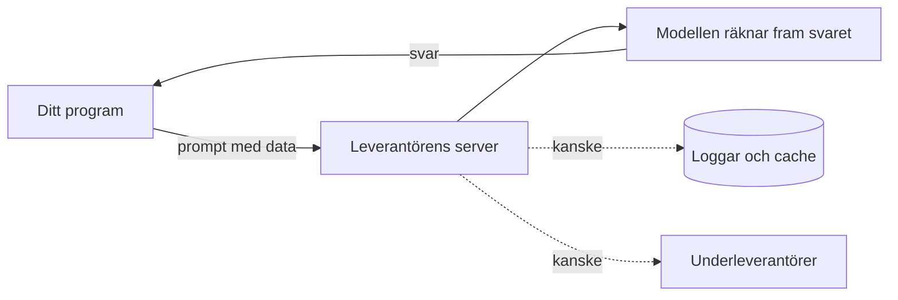

# 4. Var körs modellen?

Samma språkmodell kan köras på många ställen: i ett datacenter i USA, i ett
datacenter i Sverige eller på datorn framför dig. För säkerheten spelar
**var** och **hos vem** ofta större roll än **vilken** modell det är. I det
här kapitlet jämför du fyra driftalternativ och väljer alternativ utifrån
säkerhetsnivån från kapitel 2.

## Vad händer med datan?

När ditt program anropar en modell händer det här:

Frågorna du ställer om varje alternativ:

1. **Var** behandlas datan? I vilket land?
2. **Vem** äger leverantören, och vilka lagar lyder den under?
3. **Sparas** datan? Loggar, cache, hur länge?
4. Används datan för att **träna** modeller?
5. Finns det **avtal** (PUB-avtal) och underleverantörer?

## De fyra alternativen

| | Alternativ | Exempel |
|---|------------|---------|
| **A** | Global moln-API där data kan behandlas utanför EU, till exempel i USA | Många amerikanska AI-tjänster med standardinställningar |
| **B** | Molntjänst med databehandling inom EU | Microsoft 365 och Azure inom EU Data Boundary |
| **C** | Svensk eller europeisk leverantör där datan stannar i landet | Aixia, som kursen använder |
| **D** | Lokalt på egen dator eller server | Ollama (kapitel 5) |

### A – Global moln-API

Ofta de största och bästa modellerna, enkelt att komma igång och betalt per
användning. Men datan kan behandlas i USA. Då gäller allt från kapitel 3:
Data Privacy Framework, CLOUD Act och leverantörens villkor om lagring och
träning. Vissa globala leverantörer erbjuder EU-lagring för företagskunder.
Läs i så fall villkoren noga, för då närmar man sig alternativ B.

### B – Molntjänst inom EU: Microsoft

Microsoft har lovat att lagra och behandla kunddata för sina
företagstjänster (Microsoft 365, Azure, Dynamics 365, Power Platform) inom
EU och EFTA. Det kallas
[EU Data Boundary](https://learn.microsoft.com/en-us/privacy/eudb/eu-data-boundary-learn).
Ett företag med Microsoft 365 som är registrerat i ett EU-land omfattas.

För **Microsoft 365 Copilot** skriver Microsoft att
([källa](https://learn.microsoft.com/en-us/copilot/microsoft-365/microsoft-365-copilot-privacy)):

- trafik från EU stannar inom EU Data Boundary,
- frågor, svar och dokument **inte används för att träna** modellerna,
- Copilot bara visar dokument som användaren redan har behörighet till.

Men det finns **undantag som företagets administratör måste känna till**:

| Undantag | Vad det betyder | Vad admin kan göra |
|----------|-----------------|--------------------|
| *Flex routing* | Vid hög belastning kan modellen köras i USA, Kanada eller Australien. Påslaget som standard för kunder som skapats efter 25 mars 2026. Äldre kunder bör kontrollera inställningen ([källa](https://learn.microsoft.com/en-us/microsoft-365/copilot/copilot-flex-routing)) | Stänga av i Microsoft 365 administrationscenter |
| Webbsökning | Sökfrågor som Copilot skickar till Bing omfattas inte av EU Data Boundary ([källa](https://learn.microsoft.com/en-us/copilot/microsoft-365/manage-public-web-access)) | Stänga av webbsökning |
| Claude-modeller | Modeller från Anthropic omfattas inte av EU Data Boundary. Avstängda som standard i EU ([källa](https://learn.microsoft.com/en-us/copilot/microsoft-365/connect-to-ai-subprocessor)) | Låta dem vara avstängda |

Microsoft är ett amerikanskt företag, så frågan om CLOUD Act finns kvar
(kapitel 3). Avtalen (Microsofts dataskyddstillägg) fungerar som
PUB-avtal.

### C – Svensk leverantör: Aixia

Aixia skriver att modeller och hårdvara körs i Sverige, utan beroende av
moln utanför Europa, och att "inget lämnar landet"
([aiqu.ai/llm](https://aiqu.ai/llm/),
[aixia.se](https://aixia.se/en/aiqu-llm-hosting/)). Aixia är ett svenskt
företag och lyfter själva fram att de inte är utsatta för lagar som CLOUD
Act.

Det Aixia **inte** skriver på sina webbsidor är hur länge frågor och svar
loggas. I kursen har vi märkt att Aixias tjänst skickar tillbaka **exakt
samma svar** om du skickar exakt samma fråga två gånger, och då på en
bråkdel av tiden. Svaret sparas alltså en stund på serversidan (en *cache*).
Det är inget fel, men det visar att du alltid ska **fråga leverantören**
hur länge data sparas och få det i ett PUB-avtal innan riktiga
personuppgifter skickas.

### D – Lokalt: Ollama

Modellen körs på din egen dator eller en server hos företaget. Enligt
Ollama ser de inte dina frågor eller data när du kör lokalt
([Ollamas FAQ](https://docs.ollama.com/faq)). Datan lämnar alltså inte
datorn.

Nackdelar:

- Små modeller som får plats på en vanlig dator är sämre än de största.
- Det krävs kraftig hårdvara för bra fart.
- **Du** ansvarar för säkerheten: uppdateringar, behörigheter, backup.
- Ollama har också **molnmodeller** (namn som slutar på `-cloud`). De körs
  inte lokalt.

## Jämförelse

| | A Global | B EU-moln | C Svensk | D Lokal |
|---|----------|-----------|----------|---------|
| Datan lämnar EU? | Kan göra det | Nej, med undantag som admin styr | Nej | Nej |
| Leverantör under amerikansk lag? | Ofta | Ja (Microsoft) | Nej | Ingen leverantör |
| Modellkvalitet | Bäst | Mycket bra | Bra | Beror på datorn |
| Kostnad | Per användning | Licens per användare eller per användning | Per användning eller avtal | Hårdvara och el |
| Vem sköter driften? | Leverantören | Leverantören | Leverantören | Ni själva |
| Kontroll | Låg | Medel | Medel–hög | Hög |

Priser ändras ofta. Kontrollera aktuella priser hos leverantören.

## Beslutsmatris: nivå × alternativ

Det här är kursens **tumregel**. Den är en förenklad modell för skolan,
inte juridisk rådgivning.

| Nivå | A Global | B EU-moln | C Svensk | D Lokal |
|------|----------|-----------|----------|---------|
| 1 Öppen | ✅ | ✅ | ✅ | ✅ |
| 2 Intern | ⚠️ bara efter avtal och bedömning | ✅ | ✅ | ✅ |
| 3 Känslig | ❌ | ⚠️ med PUB-avtal och dokumenterad bedömning | ✅ med PUB-avtal | ✅ |
| 4 Skyddsvärd | ❌ | ❌ | ❌ | ⚠️ eller ingen AI alls |

**Alltid**, oavsett nivå: skicka så lite data som möjligt, ta bort namn där
det går, och låt en människa fatta beslut som påverkar personer.

### Varför ser matrisen ut så här?

- **Nivå 1:** Det gör inget om alla ser datan. Välj efter kvalitet och pris.
- **Nivå 2:** Skadan blir liten om datan läcker, men företaget vill inte
  att den sprids. En global tjänst kan vara okej om avtalet säger att datan
  inte sparas eller används för träning.
- **Nivå 3:** Personuppgifter och affärshemligheter. GDPR kräver PUB-avtal.
  Överföring till USA bygger på Data Privacy Framework, som är ifrågasatt
  (kapitel 3). Därför inte A. B fungerar om admin har stängt av undantagen
  ovan och företaget har gjort och skrivit ner en bedömning. C och D håller
  datan i Sverige.
- **Nivå 4:** Hälsa, säkerhetsskydd, exportkontroll. Skadan kan bli mycket
  allvarlig, och säkerhetsskydd och exportkontroll kan kräva att informationen
  inte lämnar företaget alls. Även D är bara okej om företagets
  säkerhetsansvarige godkänner datorn och miljön. En elevs laptop är inte
  godkänd för säkerhetsskyddsklassad information.

Tumregeln är **försiktigare** än lagen kräver i vissa fall. Sjukhus
använder till exempel molntjänster för hälsodata, med rätt avtal och
säkerhetsåtgärder. I skolprojekt är det rätt att vara försiktig.

## Exempel

| Case | Nivå | Val |
|------|------|-----|
| Chattbot som svarar på frågor ur Nordverks publicerade manualer | 1 | Vilket alternativ som helst. Aixia räcker gott |
| Månadsrapport ur serviceprotokoll, namn borttagna | 2 | B, C eller D |
| Assistent som läser kundmejl med namn | 3 | C med PUB-avtal, eller B om Nordverk redan har Microsoft 365 och admin har kontrollerat inställningarna |
| Sammanfattning av arbetsskador och sjukskrivningar | 4 | D med godkännande, eller ingen AI |

## Sammanfattning

- Fråga alltid: var behandlas datan, vem äger leverantören, sparas datan, används den för träning, finns avtal?
- B (Microsoft inom EU) har undantag som administratören måste känna till: flex routing, webbsökning och vissa modeller.
- C (Aixia) håller datan i Sverige. Fråga ändå hur länge data sparas.
- D (lokalt) ger mest kontroll men kräver hårdvara och eget säkerhetsansvar.
- Använd beslutsmatrisen och motivera ditt val.

Nästa kapitel: [Lokala modeller med Ollama](05-lokala-modeller-med-ollama.md)
