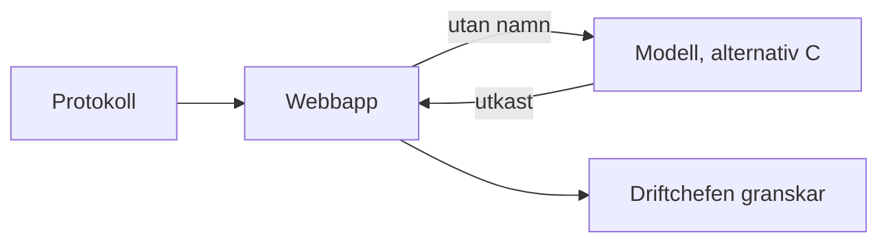

# 1. Utredningen

Innan ni bygger något ska ni förstå vad företaget behöver och hur känslig datan
är. Det är utredningens jobb. Utredningen kan komma fram till att lösningen ska
byggas på ett annat sätt än företaget tänkt sig, eller inte alls. Det är också
ett bra resultat.

Ni skriver utredningen i [mallen](mallar/utredning.md). Den ska bli några sidor,
inte mer. Läraren godkänner utredningen innan ni får företagets testdata.

💡 Öva först på ett av [exempelcasen](exempelcase/).

## Steg 1 – Förstå caset

Läraren skickar formuläret [Case från företaget](mallar/case-fran-foretaget.md)
till företaget. När ni får tillbaka det: skriv **med egna ord** i några meningar
vad företaget gör idag, vad problemet är och vad de vill ha.

⚠️ Skilj på **problemet** och **önskemålet**. Företaget kan skriva "vi vill ha en
AI som rangordnar ansökningar" när problemet är "vi hinner inte läsa alla
ansökningar". Det finns ofta fler sätt att lösa problemet.

Skriv också vilka som påverkas av lösningen: de som ska använda den, de som får
resultatet och de som **datan handlar om**. De sista är sällan med på mötet.

## Steg 2 – Gå igenom datan

Lista all data som lösningen rör. Glöm inte det användaren skriver (en anställd
kan skriva om sin hälsa i en fråga) och det lösningen skapar (en sammanfattning
kan innehålla samma uppgifter som originalet).

Fråga om varje sorts data:

1. Finns det **personuppgifter**, alltså uppgifter som kan kopplas till en person?
   Namn, e-post och telefonnummer, men också ett ordernummer som leder till en kund.
2. Finns det **känsliga personuppgifter**, till exempel om hälsa?
3. Finns det **affärshemligheter**: priser, avtal, konstruktioner?
4. Finns det teknik som omfattas av **exportkontroll** eller **säkerhetsskydd**?
5. Behövs uppgiften för att lösa problemet?

## Steg 3 – Klassa datan

Kursen använder skolans förenklade modell med fyra säkerhetsnivåer (se
[02-data-och-sakerhetsnivaer.md](../03-ai-losningar-for-foretag/02-data-och-sakerhetsnivaer.md)).
Den är inte juridisk rådgivning. Har företaget en egen klassning är det den som gäller.

| Nivå | Namn | Exempel |
|---|---|---|
| 1 | Öppen | Publicerad information, påhittad testdata |
| 2 | Intern | Interna rutiner, servicestatistik utan personuppgifter |
| 3 | Känslig | Personuppgifter, kunddata, affärshemligheter, avtal |
| 4 | Skyddsvärd | Känsliga personuppgifter (hälsa m.m.), säkerhetsskydd, exportkontrollerad teknik |

- **Den känsligaste uppgiften bestämmer nivån.** En rad om en anställds sjukdom
  gör hela filen till nivå 4, om inte raden kan tas bort.
- **Tar ni bort uppgifter innan datan skickas kan nivån bli lägre.** Skriv då vad
  ni tar bort och hur.
- **Motivera.** Skriv inte bara "nivå 3" utan "nivå 3, eftersom ärendena
  innehåller kunders namn och e-post".

## Steg 4 – Lagar och regler

Läs [03-lagar-och-regler.md](../03-ai-losningar-for-foretag/03-lagar-och-regler.md).
Skriv vilka regler som gäller för ert case och **vad de betyder för lösningen**.
De vanligaste:

| Regel | Gäller när |
|---|---|
| [GDPR](https://eur-lex.europa.eu/eli/reg/2016/679/oj), se [IMY](https://www.imy.se/verksamhet/dataskydd/det-har-galler-enligt-gdpr/) | Datan innehåller personuppgifter |
| [AI-förordningen](https://eur-lex.europa.eu/eli/reg/2024/1689/oj) | AI används i EU. Till exempel räknas AI för rekrytering som *hög risk* |
| [Exportkontroll](https://isp.se/produkter-med-dubbla-anvandningsomraden/) | Företaget har produkter som också kan användas militärt |
| [Lagen om företagshemligheter](https://www.riksdagen.se/sv/dokument-och-lagar/dokument/svensk-forfattningssamling/lag-2018558-om-foretagshemligheter_sfs-2018-558/) | Datan innehåller affärshemligheter |
| Företagets egna regler | Alltid. Fråga om de har regler för AI-tjänster |

Ni är inte jurister. Det som förväntas är att ni hittar reglerna, förklarar vad de
betyder för caset och skriver vad företaget behöver kontrollera med sina experter.

## Steg 5 – Välj driftalternativ

Var ska modellen köras? Se [04-var-kors-modellen.md](../03-ai-losningar-for-foretag/04-var-kors-modellen.md).

| Alternativ | Beskrivning |
|---|---|
| A | Global moln-API där data kan behandlas utanför EU (t.ex. i USA) |
| B | Molntjänst med databehandling inom EU, t.ex. Microsoft 365 och Azure inom EU Data Boundary |
| C | Svensk/europeisk leverantör där data stannar i landet, t.ex. Aixia |
| D | Lokalt: modellen körs på egen dator eller egen server, t.ex. Ollama |

Tumregeln:

| Nivå | Tillåtna alternativ |
|---|---|
| 1 | A, B, C eller D |
| 2 | B, C eller D. A bara efter avtal och bedömning |
| 3 | C eller D. B bara med personuppgiftsbiträdesavtal och dokumenterad bedömning |
| 4 | D, eller ingen AI-behandling alls |

Och alltid: ta bara med data som behövs, **pseudonymisera** där det går (byt ut
namn mot koder som "Kund 1") och låt en människa fatta beslut som påverkar personer.

Bland de tillåtna alternativen väljer ni det som passar bäst. Vad har företaget
redan? Hur bra behöver modellen vara? Vad kostar det?

## Steg 6 – Risker

Vad kan gå fel, och vad gör ni åt det? Läs
[06-risker-test-och-ansvar.md](../03-ai-losningar-for-foretag/06-risker-test-och-ansvar.md).

| Risk | Åtgärd |
|---|---|
| Modellen hittar på en siffra | Låt vanlig kod räkna. En människa granskar |
| En kund skriver instruktioner i sitt mejl som lurar modellen | Testa med sådana mejl. Inget skickas utan att en människa godkänt |
| Någon lägger testdata på GitHub | Datan ligger utanför repot |

## Steg 7 – Förslag på lösning

Beskriv lösningen i några meningar och rita en enkel bild som visar var datan
finns, vart den skickas och var en människa kontrollerar. Till exempel:

## Steg 8 – Testplan

Bestäm innan ni bygger hur ni ska veta att lösningen fungerar. Ta med ett test
per krav från företaget, ett test med svår data och en jämförelse med hur en
människa gör uppgiften.

| Test | Förväntat resultat |
|---|---|
| Antal besök i oktober | 5 |
| Protokoll utan arbetstid | Rapporten säger att tid saknas |
| Människa mot lösning | Tid och antal fel för båda |

## Steg 9 – Frågor och rekommendation

Samla frågorna till företaget och skicka dem på en gång via kontaktpersonen. Bra
frågor går att svara på, till exempel: *"Får protokollen skickas till en AI-tjänst
i Sverige?"* eller *"Hur lång tid tar rapporten idag?"*

Avsluta med er rekommendation: **bygg**, **bygg men annorlunda** (till exempel
ett stöd för människan i stället för något som beslutar) eller **bygg inte nu**.

Lämna sedan in utredningen till läraren.

## Övningar

**1.1** Läs de tre fallen i [exempelcase](exempelcase/). Ge varje case en
säkerhetsnivå och ett driftalternativ. Motivera med en mening.

**1.2** I [exempelcase 2](exempelcase/02-kundarenden/) har varje ärende fälten
`namn`, `epost`, `telefon`, `order` och `text`. Vilka behöver modellen? Finns
det personuppgifter kvar i `text`?

**1.3** [Exempelcase 3](exempelcase/03-teknisk-dokumentation/) innehåller
exportkontrollerad teknik. Vilka driftalternativ är tillåtna? Hur kan gruppen öva
om ingen dator klarar en lokal modell?

**1.4** Skriv tre risker med åtgärder för [exempelcase 2](exempelcase/02-kundarenden/).
Läs ärende K-2210 först.

**1.5** Gör en hel utredning av ett exempelcase med [mallen](mallar/utredning.md).
Byt med en annan grupp och granska varandras klassning.

Nästa kapitel: [Bygga lösningen](02-bygga-losningen.md)
