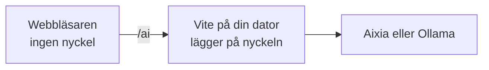

# 2. Bygga lösningen

Utredningen är godkänd. Nu bygger ni lösningen, testar den med testdata och
dokumenterar den.

## Välj teknik

Driftalternativet från utredningen styr tekniken:

| Teknik | Driftalternativ | Läs mer |
|---|---|---|
| Vue-projekt med Aixia | C | Startprojektet nedan |
| Vue-projekt med lokal modell (Ollama) | D | [05-lokala-modeller-med-ollama.md](../03-ai-losningar-for-foretag/05-lokala-modeller-med-ollama.md) |
| Agent i Microsoft 365 | B | [07-agenter-i-microsoft-365.md](../02-bygga-med-ai/07-agenter-i-microsoft-365.md) |

Vue-projektet fungerar med både Aixia och Ollama. Det enda som skiljer är
inställningarna i `.env`.

## Startprojektet

I [`startprojekt`](startprojekt/) finns ett litet Vue-projekt. Du läser in
testdatafiler, väljer en instruktion och klickar på **Generera**. Det passar till
exempel för rapporter, sortering av ärenden och frågor om dokument.

Kopiera mappen till gruppens repo. Öppna en terminal i mappen och skriv:

```
npm install
npm run dev
```

Öppna adressen som visas (oftast <http://localhost:5173>).

### Prova med exempelcase 1

1. Välj alla filer i [`exempelcase/01-manadsrapport-service/testdata/`](exempelcase/01-manadsrapport-service/testdata/)
   och i mappen `serviceprotokoll` där.
2. Välj instruktionen **Månadsrapport** och skriv uppgiften *Skriv rapporten för oktober.*
3. Kryssa i rutan. Testdatan är påhittad (nivå 1), så den får skickas till Aixia.
4. Klicka på **Generera**. Efter ungefär en halv minut kommer ett utkast.

⚠️ **Läs rapporten noga.** När vi testade blev de flesta siffror rätt, men
modellen skrev också saker som inte stod i underlaget. En gång kopierade den en
mening från septemberrapporten. En annan gång skrev den att ett fel fanns kvar,
fast protokollet sa att det var åtgärdat. Fel som låter rimliga är de farligaste.
Därför granskar en människa, och därför testar ni mot ett facit.

### Varför nyckeln inte ligger i webbläsaren

All kod i webbläsaren kan läsas av den som använder sidan (tryck F12). Låg nyckeln
där kunde vem som helst kopiera den.

Därför går anropen via en **proxy**, en mellanhand. Webbläsaren skickar till `/ai`
på din egen utvecklingsserver. Servern läser nyckeln från `.env`, lägger på den
och skickar vidare till AI-tjänsten.



Proxyn finns i [`gemensam/ai-vite.js`](../gemensam/ai-vite.js) och fungerar bara
med `npm run dev`. En publicerad app behöver en egen backend som håller nyckeln.

### Så fungerar App.vue

```js
async function lasInFiler(event) {
  for (const fil of event.target.files) {
    filer.value.push({ namn: fil.name, text: await fil.text() })
  }
}
```

`fil.text()` läser filen i webbläsaren. Inget skickas förrän du klickar på Generera.

```js
function byggUnderlag() {
  return filer.value.map((fil) => `### Fil: ${fil.namn}\n\n${fil.text}`).join('\n\n')
}
```

Alla filer läggs ihop till en text, med filnamnet som rubrik. Då kan modellen
hänvisa till rätt fil.

```js
resultat.value = await chatta([
  { role: 'system', content: valdInstruktion.value.text + '\n\n' + grundregler },
  { role: 'user', content: byggUnderlag() + '\n\nUppgift: ' + (uppgift.value || '…') },
])
```

Instruktionen blir systemprompt, tillsammans med `grundregler` från
`src/instruktioner.js` (hitta inte på, säg till när något saknas, hänvisa till
filnamn). Filerna och uppgiften blir användarens meddelande.

### Egen instruktion

Instruktionerna finns i `src/instruktioner.js`. Lägg till ett objekt i listan:

```js
{
  namn: 'Mitt case',
  text: 'Du hjälper … Gör så här: …',
},
```

Testa och ändra tills resultatet blir bra. Spara versionerna som fungerade.

### Lokal modell

Kräver utredningen alternativ D byter ni rader i `.env` (se
[05-lokala-modeller-med-ollama.md](../03-ai-losningar-for-foretag/05-lokala-modeller-med-ollama.md)):

```
AI_BASE_URL=http://localhost:11434/v1
AI_API_KEY=ollama
AI_MODEL=gpt-oss:20b
```

Starta om `npm run dev`. Nu stannar datan på din dator. Kontrollera att modellnamnet
bredvid kryssrutan har ändrats.

## Testdata och GitHub

- Bygg först med påhittad data. Byt till företagets testdata när det mesta fungerar.
- Lägg företagets data i en mapp **utanför** repot. Filväljaren kan läsa filer var
  som helst på datorn.
- Kör `git status` före varje commit och läs listan.
- Committa inte resultat eller skärmbilder med företagets uppgifter.
- Har företagets data hamnat på GitHub: säg till läraren direkt. Att ta bort filen
  räcker inte, den finns kvar i historiken.

## Testa

Följ testplanen och skriv resultatet i ett testprotokoll:

| Test | Körning | Resultat | Rätt? |
|---|---|---|---|
| Antal besök i oktober | 1 | 5 | ja |
| Antal besök i oktober | 2 | 6 | nej, tog med septembers protokoll |

- **Kör varje test flera gånger.** Modellen svarar olika varje gång.
- **Testa svår data**: saknade uppgifter, konstiga format, försök att lura modellen.
- **Låt kod räkna.** Att räkna rader gör JavaScript rätt varje gång (övning 2.4).
- **Jämför med en människa**: tid och antal fel. Var är lösningen bättre, och var
  är människan bättre?

## Dokumentera

Gruppens repo ska ha en `README.md` med: vad lösningen gör, hur man startar den,
säkerhetsnivå och driftalternativ, testresultat i korthet och vad lösningen inte
klarar.

## Övningar

**2.1** Lägg till instruktionen *Teknisk support* i `src/instruktioner.js`. Den ska
svara på frågor om dokumenten i [exempelcase 3](exempelcase/03-teknisk-dokumentation/),
ange dokument-ID och säga till när svaret saknas. Testa med fråga 1 och 7 i
`testfragor.md`.

**2.2** Visa ungefär hur många tokens filerna är. Räkna med 4 tecken per token.
Visa en varning över 20 000. Ledtråd: `computed`.

**2.3** Skriv en funktion som byter ut e-postadresser och telefonnummer mot
`[E-POST]` och `[TELEFON]` innan texten skickas. Lägg till en knapp *Visa det som
skickas*. Testa med [exempelcase 2](exempelcase/02-kundarenden/). Vilka
personuppgifter finns kvar?

**2.4** Låt kod räkna larmen per larmkod i `driftlarm-oktober.csv` i
[exempelcase 1](exempelcase/01-manadsrapport-service/) och skicka med resultatet.
Blir rapporten bättre?

**2.5** (Om ni har en dator som klarar det.) Kör exempelcase 3 mot en lokal modell
i Ollama. Jämför svar och svarstid med Aixia.

Nästa kapitel: [Demonstrationen](03-demonstration.md)
