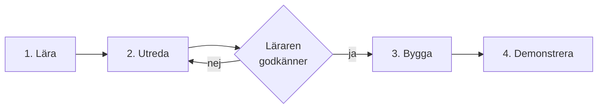

# Modul 04 – Företagsprojektet

I den här modulen får din grupp ett **riktigt case från ett företag**. Ni
utreder caset och hur känslig datan är, bygger en lösning med företagets
testdata och visar lösningen för företaget.

Ni använder allt från kursen: hur man bygger med språkmodeller
([modul 01](../01-generativ-ai/README.md) och [modul 02](../02-bygga-med-ai/README.md))
och hur man tänker när en AI-lösning görs åt ett företag
([modul 03](../03-ai-losningar-for-foretag/README.md)).

## Det här kan du efter modulen

- Ta reda på vad ett företag egentligen behöver
- Klassa företagets data med säkerhetsnivå 1–4 och välja driftalternativ A–D
- Hitta vilka lagar och regler som gäller för caset
- Bygga och testa en lösning med en språkmodell
- Hålla företagets data borta från GitHub och från fel tjänster
- Jämföra hur lösningen och en människa gör samma uppgift
- Visa lösningen för företaget och berätta ärligt vad den inte klarar

## Projektets faser

Ni får inte företagets testdata förrän läraren har godkänt er utredning.

| Fas | Vad ni gör | Kapitel | Det här lämnar ni in |
|---|---|---|---|
| 1. Lära | Går igenom modul 01–03 och övar på ett [exempelcase](exempelcase/) | Modul 01–03 | Övningarna |
| 2. Utreda | Läser caset, klassar datan, väljer driftalternativ, ställer frågor | [01 – Utredningen](01-utredning.md) | [Utredning](mallar/utredning.md) |
| 3. Bygga | Bygger lösningen och testar den med testdata | [02 – Bygga lösningen](02-bygga-losningen.md) | Lösningen, testprotokoll, README |
| 4. Demonstrera | Visar lösningen för företaget | [03 – Demonstrationen](03-demonstration.md) | [Demoplan](mallar/demo.md) och demo |

I modulen finns också ett [startprojekt](startprojekt/) i Vue,
[mallar](mallar/) och tre [exempelcase](exempelcase/) med påhittad data.
Lösningsförslag finns i [losningar.md](losningar.md). Försök själv först!

## Arbete i grupp

Ni arbetar i grupper om 3–4. Fördela rollerna. Alla skriver kod och alla ska kunna
förklara utredningen.

| Roll | Ansvarar för |
|---|---|
| Kontaktperson | All kontakt med företaget |
| Utredningsansvarig | Att utredningen blir klar |
| Utvecklingsansvarig | Att koden fungerar och att repot är i ordning |
| Testansvarig | Testplanen och testprotokollet |

**En nyckel per grupp.** Gruppen får en nyckel till AI-tjänsten av läraren. Den
ligger i `.env` och skickas aldrig i chatt, mejl eller på GitHub. Tror ni att
nyckeln har läckt: säg till läraren, så byts den.

## Regler för företagets data

1. **Aldrig på GitHub**, om inte företaget har godkänt det skriftligt. Det gäller
   också utdrag, skärmbilder och resultat med företagets uppgifter. Lägg datan i en
   mapp **utanför** repot.
2. **Ingen data i fel driftalternativ.** Datan skickas bara dit som utredningen
   kom fram till. Har ni valt lokal modell (D) får den inte skickas till Aixia,
   inte ens för att testa.
3. **Inte i andra AI-verktyg.** Klistra aldrig in företagets data i ChatGPT,
   Copilot eller liknande när ni ber om hjälp med koden.
4. **Bara det som behövs.** Ta bort namn och andra personuppgifter när det går.
5. **Radera efteråt**, om inte företaget har sagt något annat.

Har något gått fel: säg till läraren direkt.

## Bedömning

Projektet bedöms mot kursen **Artificiell intelligens nivå 1**. Det täcker
bland annat det här centrala innehållet:

- *Vikten av data, datakvalitet för AI och val av data* – klassningen och testdatan
- *Översikt över processen för problemlösning med AI* – faserna i projektet
- *Tolkning och bearbetning av naturligt språk (NLP)* – lösningen
- *Jämförelse mellan hur enklare lösningar med AI fungerar och hur en människa
  löser samma problem* – jämförelsen i testerna
- *Normer samt lagar och andra bestämmelser som gäller AI* – utredningen
- *Etiska dilemman, däribland transparens* och *möjligheter och risker* – risker,
  vem som beslutar, begränsningar i demon

Betygskriterierna har fem delar. Skillnaden mellan E, C och A ligger i
Skolverkets värdeord:

| Kriterium | E | C | A | Syns i projektet som |
|---|---|---|---|---|
| Kunskaper om AI, tillämpningar, tekniker och beståndsdelar | godtagbara | goda | mycket goda | Ni förklarar hur lösningen fungerar och varför den kan svara fel |
| Använder AI för att lösa enkla problem | med viss säkerhet | med säkerhet | med god säkerhet | Lösningen fungerar, är testad och ni kan rätta fel |
| Jämförelser av mänsklig och artificiell intelligens | enkla | välgrundade | välgrundade och nyanserade | Jämförelsen med hur en människa gör uppgiften |
| Redogör för lagar och andra bestämmelser | godtagbart | utvecklat | välutvecklat | Lagar och regler i utredningen |
| Resonemang om möjligheter och risker | enkla | utvecklade | utvecklade och nyanserade | Risker, säkerhetsnivå och driftalternativ |

Exempel: En *enkel* jämförelse säger att AI:n var snabbare. En *välgrundad*
bygger på tid och fel som ni mätt. En *nyanserad* visar också i vilka delar
människan är bättre och varför. Läraren bedömer hela kursen, inte bara projektet.

## Det här behöver du

- Allt från modul 01–03: Node.js, VS Code och gruppens nyckel i `.env`
- Ett repo för gruppen på GitHub (utan företagets data)
- Om caset kräver lokal modell: en dator som klarar Ollama, se
  [05-lokala-modeller-med-ollama.md](../03-ai-losningar-for-foretag/05-lokala-modeller-med-ollama.md)
- Om ni bygger i Microsoft 365: rätt behörigheter, se
  [07-agenter-i-microsoft-365.md](../02-bygga-med-ai/07-agenter-i-microsoft-365.md)
