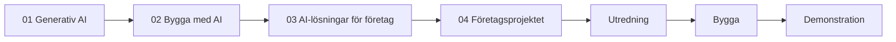

# Generativ AI – från första anropet till AI-lösningar för företag

Det här materialet tar dig från "vad är en språkmodell?" hela vägen till att
utreda, bygga och demonstrera en AI-lösning för ett riktigt företag.

Du lär dig först hur generativ AI fungerar och hur man bygger med språkmodeller
från JavaScript. Sedan lär du dig tänka som den som ansvarar för en AI-lösning:
vilken data det gäller, vilka lagar som styr och var modellen får köras.
Till sist får din grupp ett case från ett företag som ni löser och visar upp.

## Kursens upplägg

| Modul | Innehåll |
|-------|----------|
| [01 – Generativ AI](01-generativ-ai/) | Vad en språkmodell är, ditt första anrop, chatt och systemprompt, promptteknik och strukturerad utdata (JSON) |
| [02 – Bygga med AI](02-bygga-med-ai/) | Rapporter från befintliga rapporter, RAG med sökning och embeddings, verktygsanrop, agenter, MCP och agenter i Microsoft 365 |
| [03 – AI-lösningar för företag](03-ai-losningar-for-foretag/) | Från behov till lösning, säkerhetsnivåer, lagar och regler, var modellen körs, lokala modeller och risker, test och ansvar |
| [04 – Företagsprojektet](04-foretagsprojektet/) | Utred ett case från ett företag, bygg lösningen med företagets testdata och demonstrera den |

Läs modulerna i ordning. Varje modul har en `README.md` med
innehållsförteckning och numrerade kapitel.

## Det gemensamma exemplet: Nordverk AB

Genom modul 01 och 02 bygger du stegvis **Nordverk-assistenten** åt det
påhittade företaget Nordverk AB, som tillverkar och servar industripumpar.
Assistenten svarar på kundfrågor, plockar ut fakta ur serviceprotokoll, skriver
månadsrapporter, söker i manualer och använder verktyg. Företaget och all data
i [`data/nordverk/`](data/nordverk/) är påhittade.

I modul 03 och 04 byter du perspektiv. Nu är frågan inte bara *hur* du bygger,
utan *om* och *var* det är lämpligt att bygga, utifrån datans säkerhetsnivå.

## AI-tjänsten: Aixia

Kodexemplen använder språkmodeller hos **Aixia** via ett API som fungerar som
OpenAI:s.

| Modell | Används till |
|--------|--------------|
| `gpt-oss-120b` | Chatt, text, JSON och agenter |
| `bge-m3` | Embeddings till RAG |

Samma kod fungerar mot en lokal modell i [Ollama](https://ollama.com/). Då
byter du bara adress och modellnamn i `.env`, se modul 03.

## Kom igång

1. Installera [Node.js](https://nodejs.org/) version 22 eller senare (LTS) och [VS Code](https://code.visualstudio.com/).
2. Klona repot och öppna det i VS Code.
3. Kopiera `.env.example` till `.env` i repots rotmapp och fyll i nyckeln du fått.
4. Kör `npm install` i rotmappen.
5. Börja med [modul 01](01-generativ-ai/).

Kodexemplen är små **Vue-projekt**, som `kvittra-vue` i kursen om databaser.
Du startar dem med `npm install` och `npm run dev` i projektets mapp. Några
exempel som måste köras på servern, till exempel MCP-servern, är Node-skript
som du kör med `node` från rotmappen.

## Nyckeln är din grupps ansvar

⚠️ API-nyckeln är ett lösenord. Den får aldrig ligga i kod som läggs på GitHub
och aldrig i kod som körs i webbläsaren.

- Nyckeln står bara i `.env`, och `.env` står i `.gitignore`.
- Vue-projekten skickar sina anrop via utvecklingsservern. Den lägger på
  nyckeln på din dator, så nyckeln syns aldrig i webbläsaren. Hur det fungerar
  står i [`gemensam/ai-vite.js`](gemensam/ai-vite.js) och förklaras i modul 01.
- Har nyckeln hamnat på fel ställe ska du säga till direkt, så att den
  kan spärras.

## Mappar

| Mapp | Innehåll |
|------|----------|
| `gemensam/` | AI-klienten för Node-skript (`ai.js`), Vite-pluginet som skyddar nyckeln (`ai-vite.js`) och en mall för nya Vue-projekt (`vue-mall/`) |
| `data/nordverk/` | Påhittade manualer, serviceprotokoll och kundärenden |
| `presentation/` | Introduktionspresentation om generativ AI |
